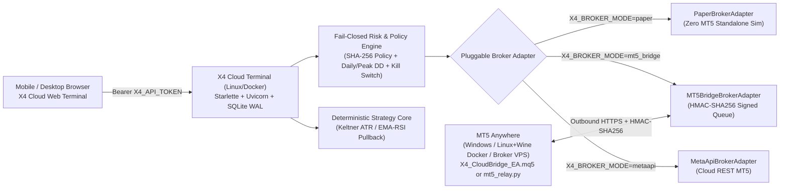

# X4 Cloud Terminal

> **No `.edu` email. No Credit/Debit Card. No paid Windows Server VM.**  
> Cross-platform cloud-native trading terminal, fail-closed risk engine, HMAC-SHA256 MetaTrader 5 HTTPS bridge, and Linux+Wine MT5 container built as a direct zero-cost alternative to **Microsoft Azure for Students** Windows VMs.

[](requirements.txt)
[](docker-compose.yml)
[](LICENSE)

---

## Why This Exists (Replacing Azure for Students)

Many MT5 trading setups tell you to get **Microsoft Azure for Students** ($100 free credit, no card) to spin up a 2–4 GB **Windows Server VM** because standard MT5 Python terminals are locked to Windows (`MetaTrader5` C-extension, Windows DPAPI, `taskkill`/PowerShell).

**If you don't have a `.edu` / `.edu.pk` email or a credit/debit card**, you hit a wall.

**X4 Cloud Terminal** removes every Windows-only dependency from the core terminal and gives you **4 real, zero-`.edu`, zero-card deployment paths**:

| Option | `.edu` Email Needed? | Credit/Debit Card Needed? | Runs MT5? | Best For |
|---|---|---|---|---|
| **Azure for Students** *(Old Guide)* | Yes (`.edu` / Student ID) | No | Yes (Windows VM) | College students with verified `.edu` |
| **1. Render Free Tier + X4 Cloud Bridge EA** | **No** | **No** | Remote MT5 via HTTPS EA | Free 24/7 cloud dashboard & risk brain (750 hrs/mo free; sleeps if idle >15m) |
| **2. Linux + Wine + MT5 Docker Stack** (`docker-compose --profile mt5-wine`) | **No** | **No** | **Yes (Full MT5 + noVNC in Linux!)** | Any Linux machine, WSL2, spare laptop, or Docker host — zero Windows license |
| **3. Home PC / Spare Laptop + Cloudflare Quick Tunnel** | **No** | **No** | **Yes (Native MT5 or Wine)** | True 24/7 $0 private cloud with public HTTPS mobile access & auto-restart |
| **4. Standalone Paper / MetaApi Cloud Mode** | **No** | **No** (Paper) | Paper Sim or MetaApi REST | Testing strategies & policies immediately in cloud with zero MT5 install |

---

## Architecture



### Key Engineering Improvements Over Windows-Only Terminals
- **Zero Windows Lock-In**: Pure cross-platform Python 3.11+ (`starlette`, `uvicorn`, `httpx`, `cryptography`, `PyYAML`). Runs identically on Linux, macOS, Docker, WSL2, Raspberry Pi, and Windows.
- **Cross-Platform Secret Vault (`x4_cloud/vault.py`)**: Replaces Windows DPAPI with **AES-256-GCM + scrypt** key derivation and per-entry salt/nonce/AAD binding.
- **Fail-Closed Safety Model (`x4_cloud/policy.py`)**:
  - Boots **SAFE-HALTED** by default (`X4_AUTO_START_ENGINE=false`).
  - **Real accounts are double-locked**: blocked unless BOTH `allow_real: true` in YAML policy AND `REAL_EXECUTION_UNLOCK=true` in environment (plus `InpAllowRealAccount = true` inside the MT5 EA).
  - Enforces per-trade risk sizing, required Stop Loss, spread cap, stale-quote guard, daily loss circuit breaker, max overall drawdown kill switch, and a **SHA-256 hash-chained SQLite WAL audit log**.
- **HMAC-SHA256 Outbound MT5 Bridge**: Your MT5 terminal only makes *outbound* HTTPS requests (`WebRequest` in `X4_CloudBridge_EA.mq5` or `bridge_agent/mt5_relay.py`) signed with `X-X4-Timestamp` + `X-X4-Signature` (180s replay window). No inbound firewall ports, no static IP, works behind university/home NAT or mobile hotspots.

---

## Quick Start (Pick Your Path)

### Path 1: Deploy Free on Render.com (No Credit Card, No `.edu` Email)
1. Fork or clone this repository on GitHub.
2. Sign up at [render.com](https://render.com) with your GitHub account (no credit card required for the Free tier).
3. Click **New → Blueprint**, select this repo, and Render reads [`render.yaml`](render.yaml) automatically:
   - Auto-generates strong random `X4_API_TOKEN` and `X4_BRIDGE_SECRET`.
   - Boots in `X4_BROKER_MODE=mt5_bridge` (or switch to `paper` to test standalone immediately).
4. Copy your generated `X4_API_TOKEN` to log into the web dashboard at `https://<your-service>.onrender.com`.
5. Attach `mql5/X4_CloudBridge_EA.mq5` to any MT5 Demo chart with your Render URL and `X4_BRIDGE_SECRET`.

> **Honest Free-Tier Note:** Render's free tier gives 750 instance hours/month and spins down after 15 minutes of inactivity, with an ephemeral filesystem on redeploy. Always start on **Paper or Demo** accounts and treat free PaaS storage as non-durable unless backed by external storage.

---

### Path 2: Full Linux + Wine + MetaTrader 5 Docker Box (Replaces Azure Windows VM)
Run both **X4 Cloud Terminal** and **MetaTrader 5 GUI (accessible in browser via noVNC)** on any Linux PC, WSL2, or Docker server — **zero Windows license required**:

```bash
cp .env.example .env
# Edit .env and set X4_BROKER_MODE=mt5_bridge, X4_API_TOKEN, X4_BRIDGE_SECRET

docker compose --profile mt5-wine up -d --build
```

- **X4 Cloud Terminal UI**: `http://127.0.0.1:8501`
- **MetaTrader 5 Browser Desktop (noVNC)**: `http://127.0.0.1:6080/vnc.html`
- Inside MT5, go to **Tools → Options → Expert Advisors**:
  1. Check **Allow Algorithmic Trading**.
  2. Check **Allow WebRequest for listed URL** and add `http://x4-cloud:8501` (or your Render HTTPS URL).
  3. Attach `X4_CloudBridge_EA` from `MQL5/Experts` and paste your `X4_BRIDGE_SECRET`.

---

### Path 3: Zero-Cost 24/7 Home PC / Spare Laptop + Free Cloudflare HTTPS Tunnel
Turn an existing Windows or Linux laptop into your own 24/7 private cloud server accessible from your phone over HTTPS (no credit card, no `.edu`, no router port-forwarding):

**Windows (PowerShell):**
```powershell
pip install -r requirements.txt
.\scripts\start_home_cloud.ps1 -WithCloudflareTunnel
```

**Linux / WSL2 / macOS:**
```bash
pip install -r requirements.txt
chmod +x scripts/start_home_cloud.sh
./scripts/start_home_cloud.sh --tunnel
```

---

### Path 4: Local Standalone Paper Mode (30 Seconds)
```bash
git clone https://github.com/xity4uu-a11y/x4-cloud-terminal.git
cd x4-cloud-terminal
pip install -r requirements.txt
cp .env.example .env
python run.py
```
Open `http://127.0.0.1:8501` in your browser.

---

## Connecting MetaTrader 5 to X4 Cloud Terminal

You have two bridge options:

1. **Pure MQL5 Expert Advisor (`mql5/X4_CloudBridge_EA.mq5`)** *(Recommended — zero Python needed on MT5 machine)*:
   - Uses native MT5 `CryptEncode(CRYPT_HASH_SHA256)` for HMAC-SHA256 signatures.
   - Demo-locked by default (`InpAllowRealAccount = false`).
   - Pushes account balance, equity, margin, live bid/ask quotes, and open positions every N seconds and pulls risk-approved orders.

2. **Python MT5 Relay (`bridge_agent/mt5_relay.py`)** *(For Windows or Windows-Python-under-Wine)*:
   ```bash
   pip install -r bridge_agent/requirements-bridge.txt
   export X4_CLOUD_URL="https://your-x4-cloud-host"
   export X4_BRIDGE_SECRET="your-shared-secret"
   python bridge_agent/mt5_relay.py
   ```

---

## API Reference

| Method | Endpoint | Auth | Purpose |
|---|---|---|---|
| `GET` | `/healthz` | Public | Liveness & broker connection probe |
| `GET` | `/api/status` | `Bearer X4_API_TOKEN` | Full account, policy, quotes, positions, orders, and audit chain snapshot |
| `POST` | `/api/engine/start` | `Bearer X4_API_TOKEN` | Start deterministic strategy supervisor |
| `POST` | `/api/engine/stop` | `Bearer X4_API_TOKEN` | Pause strategy supervisor |
| `POST` | `/api/engine/kill-switch` | `Bearer X4_API_TOKEN` | Trigger or reset persistent SQLite kill switch |
| `POST` | `/api/orders` | `Bearer X4_API_TOKEN` | Submit risk-validated order |
| `POST` | `/api/positions/{ticket}/close` | `Bearer X4_API_TOKEN` | Close open position (direct or queued to MT5 bridge) |
| `POST` | `/api/bridge/sync` | HMAC-SHA256 (`X-X4-Signature`) | MT5 EA / Relay state push + pending command pull |
| `POST` | `/api/bridge/ack` | HMAC-SHA256 (`X-X4-Signature`) | MT5 execution receipt acknowledgement |

---

## Running Tests

```bash
pip install -r requirements.txt pytest
pytest -v
```

---

## Security & Trading Disclaimer

- **Paper & Demo First:** This software defaults to `paper` / `demo` fail-closed mode. Automated trading carries real financial risk; never unlock real-account execution until you have thoroughly tested on a Demo account.
- **Protect Your Tokens:** Never commit `.env`, API tokens, or broker passwords to Git. Always set strong random `X4_API_TOKEN` and `X4_BRIDGE_SECRET` values before exposing the terminal publicly.
- **No Unverified Claims:** This repository provides trading infrastructure, risk governance, and zero-cost cloud deployment tooling — not financial advice or guaranteed profitability.
